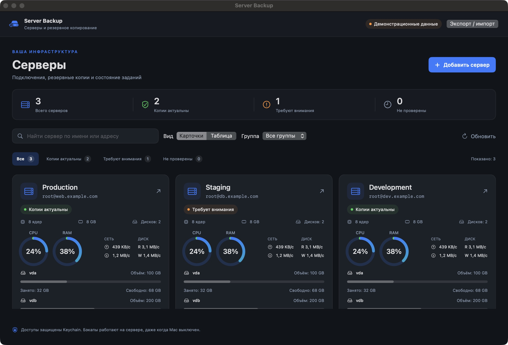
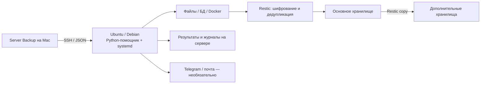
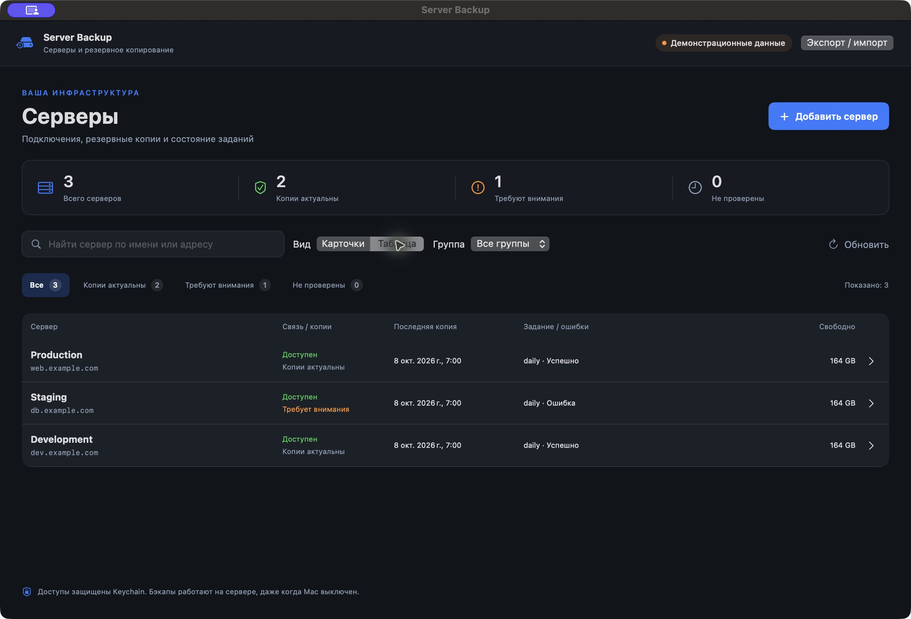
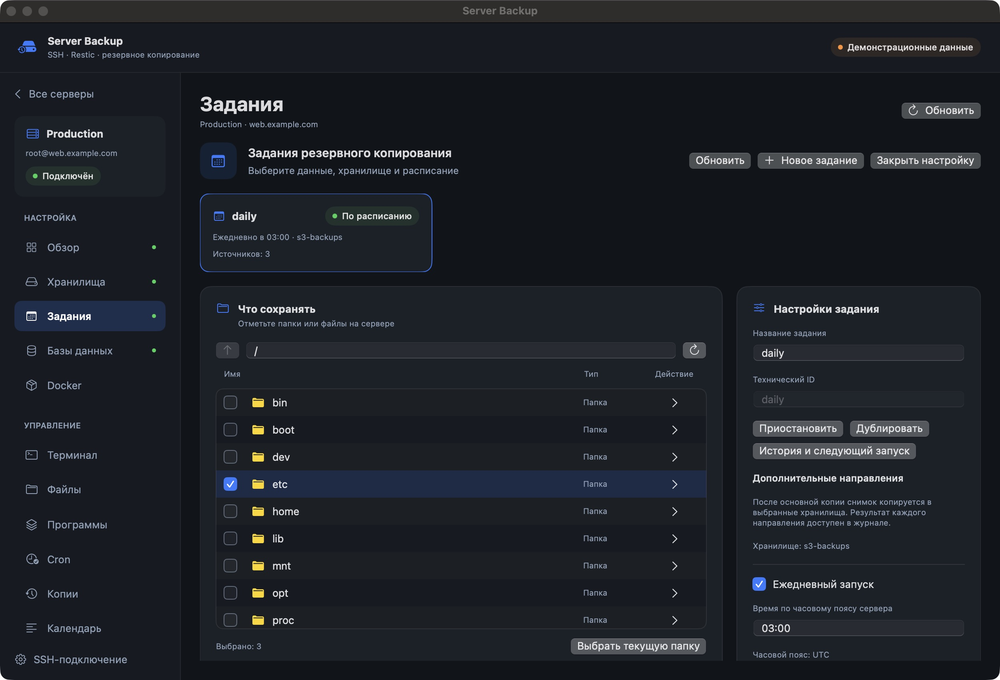
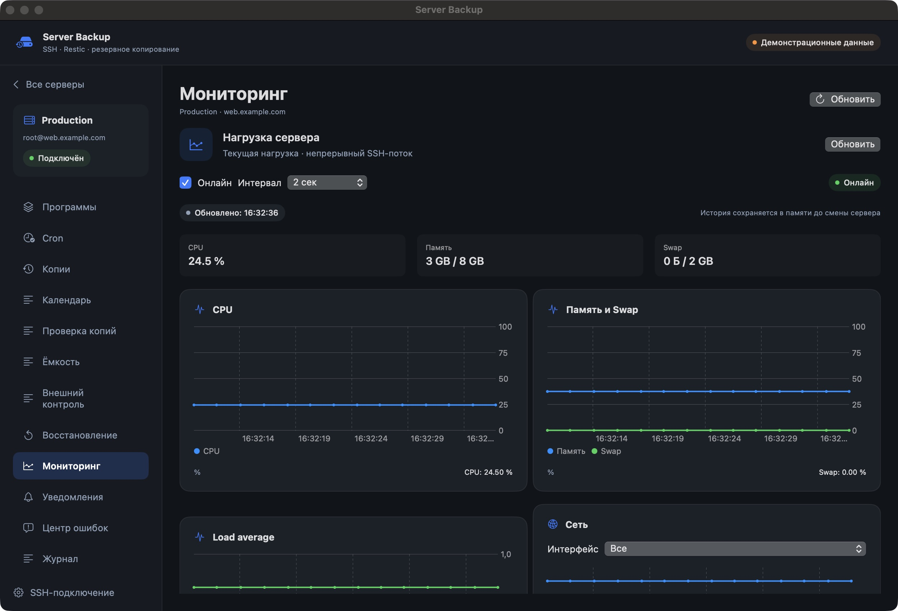
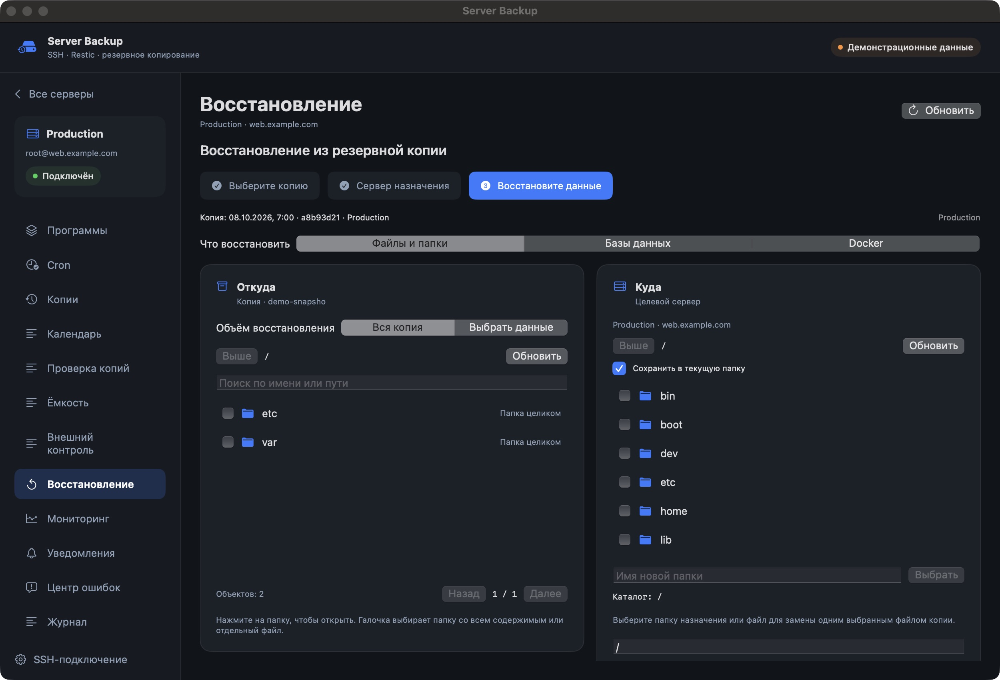

# Server Backup

**macOS-приложение для резервного копирования и управления Linux-серверами через SSH.**

Server Backup настраивает Restic, хранилища, расписания, базы данных и Docker из одного русского интерфейса. Бэкапы запускаются на сервере через systemd и продолжают работать, когда приложение закрыто или Mac выключен.

**Версия:** 1.9.1 · **Mac:** Apple Silicon, macOS 14+ · **Серверы:** Ubuntu / Debian.



> Скриншоты сделаны в отдельной сборке на демонстрационных данных. Они показывают интерфейс, а не результаты подключения к рабочим серверам.

## Возможности

| Раздел | Что можно делать |
| --- | --- |
| Серверы | Добавлять SSH-подключения, проверять ключ сервера, искать и группировать серверы, выбирать карточки или компактную таблицу |
| Хранилища | Подключать каталог/диск, SFTP, S3 и Яндекс Диск; создавать новый или подключать существующий репозиторий |
| Задания | Выбирать файлы, папки и смонтированные диски, исключения, время, срок хранения и дополнительные направления |
| Базы данных | Создавать согласованные дампы MySQL, MariaDB и PostgreSQL; использовать базовую копию и binlog/WAL при выполненных требованиях |
| Docker | Сохранять Compose, bind mounts и named volumes; выбирать дамп БД, временную остановку или копирование работающего контейнера |
| Копии | Смотреть файлы снимка, размеры, версии файла, сравнивать снимки и выбранные файлы с сервером |
| Восстановление | Выбирать копию по дате, данные и сервер назначения; восстанавливать папку или конкретный файл, отдельно импортировать БД и Docker |
| Проверка копий | Выполнять выборочное восстановление либо полную проверку файлов, импорта БД, томов и Compose |
| Мониторинг | Смотреть графики CPU, RAM, swap, сети и дисков, свободное место, процессы и Docker |
| Управление | Использовать интерактивный терминал, файловый менеджер, редактор конфигураций, каталог пакетов и редактор Cron |
| Контроль | Смотреть календарь, историю операций, центр ошибок и прогноз ёмкости; настроить внешний сервер-наблюдатель |
| Уведомления | Настроить необязательные Telegram и электронную почту; отправлять сообщения с сервера без участия Mac |

## Как работает резервирование

1. Приложение подключается по SSH, проверяет инструменты и отправляет JSON-запрос серверному помощнику на Python.
2. Настройки задания и доступы к хранилищу сохраняются на сервере. Для расписания создаются systemd-служба и таймер.
3. Задание подготавливает согласованные дампы/журналы БД и выбранные Docker-данные.
4. Restic шифрует данные и создаёт снимок в выбранном репозитории. Первый запуск сохраняет все выбранные данные; следующие используют уже существующие блоки и добавляют новые или изменённые.
5. Дополнительные направления получают тот же снимок через Restic copy. Итог каждого направления сохраняется отдельно.
6. Сервер записывает результат, выполняет настроенные проверки и отправляет уведомления. После повторного подключения приложение получает сохранённую историю и активные операции.

Каждая копия доступна как отдельная версия файлов, хотя одинаковые блоки хранятся совместно. **Размер файлов в снимке, новые добавленные данные и общий объём репозитория — разные показатели.**



## Быстрый старт

1. Соберите приложение по инструкции ниже и откройте `Server Backup.app`.
2. Нажмите **«Добавить сервер»**, укажите SSH-доступ и подтвердите проверенный отпечаток ключа.
3. Откройте сервер. В **«Обзоре»** нажмите установку инструментов, если они отсутствуют.
4. В **«Хранилищах»** подключите место хранения и отдельно создайте новый репозиторий либо проверьте существующий.
5. При необходимости добавьте подключения к БД и настройки Docker.
6. Создайте **«Новое задание»**: выберите хранилище, данные, исключения, расписание и срок хранения.
7. Сохраните задание, выполните **«Пробный запуск без записи»**, затем настоящий бэкап.
8. Восстановите тестовый файл в отдельный каталог и проверьте результат.

По умолчанию: ежедневно в **03:00 по часовому поясу сервера**, 14 ежедневных и 4 еженедельных копии. По воскресеньям после успешного бэкапа выполняются очистка и проверка структуры. Таймер допускает небольшую случайную задержку.

Выбор `/` не включает другие подключённые файловые системы: каждый дополнительный диск выбирается явно.

**Подробные шаги:** [руководство пользователя](docs/USER_GUIDE.md).

## Скриншоты

### Компактный обзор серверов



### Данные и настройки задания



### Мониторинг онлайн



### Восстановление: откуда и куда



## Требования

**На Mac:** macOS 14+, Apple Silicon, Xcode Command Line Tools и Swift 6 для сборки. Python 3 нужен для серверных unit-тестов, Docker — только для явно запускаемых интеграционных проверок.

**На сервере:** Ubuntu/Debian, SSH, Python 3.8+, systemd, root либо настроенный `sudo -n` для административных действий. Для установки нужен доступ к подписанным репозиториям ОС. Для конкретной БД нужны её клиентские инструменты; Docker-функции требуют Docker, Compose-функции — плагин Docker Compose.

Установка инструментов бэкапа использует отдельные временные источники и индексы официальных репозиториев текущего выпуска ОС. Она не меняет сторонние APT-источники и не отключает проверку подписей. Ошибки Docker/Yarn/NodeSource не исправляются для обычного системного `apt update`.

## Сборка из исходников

```sh
git clone git@github.com:nekl3103/server-backup.git
cd server-backup
xcode-select --install  # если Command Line Tools ещё не установлены
bash scripts/prepare-dependencies.sh
bash scripts/package.sh
```

`prepare-dependencies.sh` скачивает закреплённую версию rclone для Apple Silicon из официального источника и проверяет SHA-256 архива. SwiftTerm находится в `vendor/SwiftTerm` вместе с лицензией и описанием локальных изменений.

Готовые файлы:

- `dist/release/Server Backup.app` — приложение;
- `dist/Server-Backup-1.9.1-arm64.dmg` — установочный образ.

Подпись локальная **ad-hoc**, нотариального заверения Apple нет. Для доверенной локальной сборки macOS может потребовать разрешить запуск через **«Системные настройки → Конфиденциальность и безопасность»**.

`.app`, `.dmg`, бинарный rclone, локальные журналы и отчёты интеграций не хранятся в Git. Этот репозиторий содержит исходники, документацию, тесты и скриншоты.

## Проверки

```sh
python3 -m unittest discover -s tests
```

Сборочный скрипт выполняет встроенные self-tests, локальную проверку PTY, проверку подписи и контрольной суммы DMG.

Интеграции запускаются **отдельно и явно** в новых локальных Docker-контейнерах:

```sh
sh tests/fixtures/database-journals/build.sh
python3 tests/integration_database_journals.py pg mysql maria
python3 tests/integration_local_resilience.py
python3 tests/integration_volume_verification.py
python3 tests/integration_history_ssh.py
```

SSH-тест использует только собственный контейнер с портом на `127.0.0.1`. Остальные проверки не публикуют порты хосту; внешний контроль проверяется в отдельной локальной сети. Старые интеграционные скрипты в `tests/` требуют своих подготовленных окружений и не входят в этот список.

Для 1.9.1 прошли **163 unit-теста**, реальные локальные восстановления PostgreSQL/MariaDB/MySQL, файлов и Docker-тома, проверка смешанного снимка, SFTP, внешнего контроля и истории при занятом SSH-канале. Точная область проверки и непроверенные сценарии описаны в [VALIDATION.md](VALIDATION.md).

## Доступы и ограничения

- На Mac секреты сохраняются в Keychain. Для восстановления после потери Mac предусмотрен зашифрованный экспорт профилей с отдельным паролем.
- Для автономной работы задания хранят серверные доступы в файлах помощника с ограниченными правами. Доступ root к серверу даёт доступ и к этим настройкам.
- Ключ SSH проверяется строго; изменение ключа требует отдельного подтверждения.
- Restic шифрует содержимое репозитория. Для восстановления нужны доступ к хранилищу и пароль репозитория.
- Выбор диска означает выбор его файловой системы. **Образ ОС, разделов и загрузчика не создаётся.** На новом сервере необходимы совместимые ОС, сервисы и настройки.
- Журнальные бэкапы БД требуют заранее настроенных binlog/WAL и подходящих клиентских версий; приложение не включает журналирование работающей БД автоматически.
- Полная проверка восстановления не запускает восстановленный сайт/Compose-приложение и не доказывает восстановление всей ОС.
- Постоянная история метрик нагрузки не ведётся: графики сохраняются в памяти приложения.

## Структура проекта

```text
Sources/ServerBackup/   SwiftUI, SSH, Keychain, терминал и интерфейс
backend/helper.py      Серверные операции, Restic, БД, Docker и systemd
scripts/               Подготовка зависимостей, иконка, сборка и упаковка
tests/                 Unit-тесты и изолированные интеграции
docs/                  Руководство и демонстрационные скриншоты
vendor/                SwiftTerm и сведения о rclone
VALIDATION.md          Подтверждённые проверки и ограничения
```

## Документация зависимостей

- [Restic: работа с репозиториями](https://restic.readthedocs.io/en/stable/045_working_with_repos.html)
- [Restic: JSON и автоматизация](https://restic.readthedocs.io/en/stable/075_scripting.html)
- [rclone: Яндекс Диск](https://rclone.org/yandex/)
- [SwiftTerm](https://github.com/migueldeicaza/SwiftTerm)

Лицензии включённых зависимостей находятся в `vendor/SwiftTerm/LICENSE` и `vendor/rclone/LICENSE.txt`.
